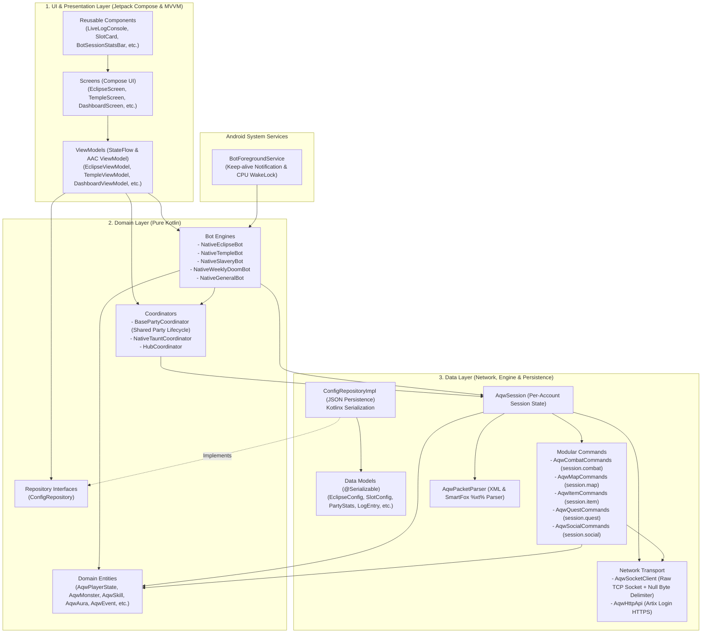

# AQW Android Bot

An automated gaming bot application for **AdventureQuest Worlds (AQW)** built for the Android platform. Developed using **Kotlin**, **Jetpack Compose**, and structured around **3-Tier Clean Architecture** for performance, socket stability, and strict separation of concerns.

---

## Table of Contents

- [Features](#features)
- [System Architecture](#system-architecture)
  - [High-Level Diagram](#high-level-diagram)
  - [Layer Breakdown](#layer-breakdown)
  - [Modular Commands System](#modular-commands-system)
- [Project Directory Structure](#project-directory-structure)
- [Tech Stack & Libraries](#tech-stack--libraries)
- [Data Flow](#data-flow)
- [Background Service & Keep-Alive](#background-service--keep-alive)
- [Usage & Build Instructions](#usage--build-instructions)

---

## Features

AQW Android Bot includes specialized automation modules tailored for various in-game mechanics and content:

### 1. Maid Eclipse Raid Bot (`EclipseScreen`)
- **Multi-Slot Party (4 Accounts)**: Automatic coordination of up to 4 account slots simultaneously.
- **Sun & Moon Taunt Rotation**: Automated taunt skill execution based on turn sequences and cooldown timers for Maid Eclipse.
- **Debuff & Aura Management**: Real-time tracking of *Sun's Warmth* and *Moonlight Gaze* auras, with automated *Light Gather* toggling.
- **Server Animation Messages & Dungeon Control**: Server warning packet detection (*ANIM MSG*), synchronized cell jumping, and automatic dungeon restarting upon completion.

### 2. Temple Shrine Raid Bot (`TempleScreen`)
- **Dungeon Boss Coordination**: Automation for Grimskull, Priest, Ninja, and Temple Shrine dungeon mechanics.
- **Native Taunt Coordinator**: Precise timing calculations for skill 5 and taunt rotations.

### 3. Ultra Boss Raid Bot (`UltraBossScreen`)
- **Ultra Malgor & Ultra Gramiel**: Specialized strategies for high-tier Ultra Boss encounters.
- **HP & Cell Telemetry**: Real-time boss HP monitoring, taunt turn tracking, and room occupant status.

### 4. Weekly Doom Dungeon Bot (`WeeklyDoomScreen`)
- **Weekly Quest Automation**: Efficient completion of Weekly Doom dungeon quests.
- **Multi-Account Switching**: Dynamic management and rotation of Doom accounts.

### 5. Slavery / Multi-Account Farming Bot (`SlaveryScreen`)
- **Master-Slave Farming**: Controlled multi-room and multi-account farming setups.
- **Per-Slot Role Customization**: Configurable monster targets, class setups, and attack strategies per account slot.

### 6. General & Custom Quest Bot (`GeneralBotScreen`)
- **Custom Quest & Item Farming**: Flexible bot engine for arbitrary item and quest targets.
- **Specialized Presets**:
  - **Legion Revenant**: Comprehensive farming for Legion Revenant quest chains and prerequisites.
  - **Nulgath Farming**: Automated Nulgath / Nation item quests.
  - **Void Aura**: Automated Void Aura farming for BSoA / NSOD.

### 7. Dashboard & Live Telemetry (`DashboardScreen` & `PlayerStateScreen`)
- **Hub Dashboard**: Centralized metric and status overview for all concurrently running bot modules.
- **Live Player State**: Detailed tracking of HP, MP, level, class, equipment, inventory, skill cooldowns, and active auras.
- **Live Log Console**: Real-time console logger with ANSI color code stripping (`stripAnsi()`), slot filtering, and outgoing socket packet inspection.

---

## System Architecture

The project adheres to a **3-Tier Clean Architecture** pattern (`UI` -> `Domain` -> `Data`) to ensure complete isolation between UI components, core game logic, and low-level networking.

### High-Level Diagram



### Layer Breakdown

1. **UI Layer (`froztt13.python.aqw.ui` & `viewmodel`)**
   - **Jetpack Compose**: Declarative UI built with Material 3 components.
   - **Type-Safe Navigation**: Navigation handled via `@Serializable` destination objects (`AppDestination`).
   - **MVVM Pattern**: ViewModels maintain reactive state using `StateFlow` and communicate exclusively with Domain Coordinators or Repositories.

2. **Domain Layer (`froztt13.python.aqw.domain`)**
   - **Zero Android UI Dependencies**: Pure Kotlin module with no Compose or Android UI references.
   - **Coordinators**: Party lifecycle management, slot tracking, pause/resume flow, and log stream aggregation (`BasePartyCoordinator`).
   - **Bot Engines**: Specific raid/farming business logic implementations (`NativeEclipseBot`, `NativeTempleBot`, etc.).
   - **Domain Entities & Events**: Sealed models representing game state (`AqwPlayerState`, `AqwMonster`, `AqwEvent`).

3. **Data Layer (`froztt13.python.aqw.data`)**
   - **AqwSession**: Manages individual account session states, reactive event streams (`SharedFlow<AqwEvent>`), and local log buffers.
   - **AqwPacketParser**: Parses raw TCP packets (XML policy responses, SmartFox `%xt%zm%` frames, JSON payloads) into strongly-typed `AqwEvent`s.
   - **AqwSocketClient**: Raw TCP socket implementation (`java.net.Socket`) connecting to port 5588 with null-byte (`\u0000`) framing delimiters and heartbeat pings.
   - **AqwHttpApi**: Web API client communicating with Artix HTTPS endpoints for user authentication, server tokens, and server lists.
   - **ConfigRepositoryImpl**: Manages persistent JSON configurations on disk using `kotlinx.serialization`.

### Modular Commands System

Game actions on `AqwSession` are decomposed into modular sub-command handlers:
- `session.combat` (`AqwCombatCommands`): Skill casting (1-5), auto-attacks (`gar`), target locking, cooldown/mana validation, and scroll/potion equipping.
- `session.map` (`AqwMapCommands`): Cell/pad navigation (`moveToCell`, `jumpCell`) and sole owner of map monster states.
- `session.item` (`AqwItemCommands`): Item drop collection (`getDrop`), batch pickup (`dropStack`), inventory/bank transfers, and item equipping.
- `session.quest` (`AqwQuestCommands`): Quest acceptance, completion (`tryCompleteQuest`), and reward claiming.
- `session.social` (`AqwSocialCommands`): Party invitations, acceptance, and leaving logic.

---

## Project Directory Structure

```
app/src/main/java/froztt13/python/aqw/
├── AqwApp.kt                       # Application Class
├── MainActivity.kt                 # Entry Activity & Compose Setup
│
├── ui/                             # [UI LAYER]
│   ├── components/                 # Reusable UI Widgets (LiveLogConsole, SlotCard, etc.)
│   ├── navigation/                 # AppDestination & AppNavHost (Compose Navigation)
│   ├── screens/                    # UI Screen Layouts (Dashboard, Eclipse, Temple, Slavery, etc.)
│   └── theme/                      # Material 3 Theme Definitions
│
├── viewmodel/                      # [VIEWMODEL LAYER]
│   ├── DashboardViewModel.kt
│   ├── EclipseViewModel.kt
│   ├── GeneralBotViewModel.kt
│   ├── SlaveryViewModel.kt
│   ├── TempleViewModel.kt
│   ├── UltraBossViewModel.kt
│   └── WeeklyDoomViewModel.kt
│
├── domain/                         # [DOMAIN LAYER]
│   ├── bot/                        # Native Bot Engines (Eclipse, Temple, Slavery, Doom, General)
│   ├── coordinator/                # Coordinators (BasePartyCoordinator, HubCoordinator, Taunt)
│   ├── model/                      # Domain Entities (AqwModels.kt)
│   └── repository/                 # Repository Contracts (ConfigRepository.kt)
│
├── data/                           # [DATA LAYER]
│   ├── engine/                     # Session Engine & Parser
│   │   ├── commands/               # Combat, Map, Item, Quest, Social Commands
│   │   ├── AqwPacketParser.kt      # SmartFox & XML Packet Parser
│   │   └── AqwSession.kt           # Session State & Event Pipeline
│   ├── network/                    # Sockets & Web API
│   │   ├── AqwHttpApi.kt           # Artix HTTPS Login API
│   │   └── AqwSocketClient.kt      # Raw TCP Socket Client
│   ├── model/                      # Data Config Models (EclipseConfig, SlotConfig, etc.)
│   ├── repository/                 # ConfigRepositoryImpl.kt (JSON Storage)
│   └── util/                       # Utility Extensions (StringExtensions.kt)
│
├── service/                        # [ANDROID SERVICE]
│   └── BotForegroundService.kt     # Keep-Alive Foreground Service
│
└── helper/                         # [HELPER]
    └── BatteryOptimizationHelper.kt # Battery optimization / Doze mode helper
```

---

## Tech Stack & Libraries

| Category | Technology / Library |
| :--- | :--- |
| **Language** | Kotlin (JVM 11) |
| **Android SDK** | Min SDK 26 (Android 8.0) \| Target & Compile SDK 37 |
| **UI Framework** | Jetpack Compose + Material 3 |
| **Navigation** | Navigation Compose (Type-Safe Routes) |
| **Concurrency** | Kotlin Coroutines & Flow (`StateFlow`, `SharedFlow`) |
| **Networking** | Java TCP Sockets (`java.net.Socket`) + Ktor/Http API |
| **Serialization** | `kotlinx.serialization` (JSON) |
| **Architecture** | MVVM + Clean Architecture |

---

## Data Flow

```
1. User clicks "Start Bot" on the UI (e.g., EclipseScreen)
   │
2. EclipseViewModel calls NativeEclipseBot.start(config)
   │
3. BotForegroundService is started (persistent notification & CPU WakeLock)
   │
4. NativeEclipseBot instantiates AqwSession instances for each slot account
   │
5. AqwSession authenticates via AqwHttpApi to retrieve server IP and token
   │
6. AqwSocketClient opens a TCP socket connection to the AQW game server (port 5588)
   │
7. Inbound server packets are parsed by AqwPacketParser into typed AqwEvent instances
   │
8. Modular sub-commands execute actions based on bot logic:
   - session.map (cell navigation, monster state updates)
   - session.combat (skill casting, auto attack, taunting)
   - session.quest (accepting & turning in quests)
   │
9. Session logs are emitted to AqwSession.logs and streamed reactively via StateFlow
   │
10. LiveLogConsole in Jetpack Compose updates the UI log display in real-time
```

---

## Background Service & Keep-Alive

The AQW game protocol requires a persistent TCP socket connection. To prevent Android from dropping network connections when the app is backgrounded or when the device screen turns off:

1. **`BotForegroundService`**: Runs an Android Foreground Service displaying a persistent notification while bots are active.
2. **CPU WakeLock**: Prevents the device CPU from entering a deep sleep state during active bot execution.
3. **Battery Optimization Handling**: Provides a prompt for users to exclude the app from Android Doze mode battery optimizations.

---

## Usage & Build Instructions

### Prerequisites
- Android Studio Ladybug / Meerkat or newer.
- JDK 11 or higher.
- Android SDK 37.

### Terminal Build Commands
```bash
# Compile project
./gradlew compileDebugKotlin

# Build Debug APK
./gradlew assembleDebug

# Run unit tests
./gradlew test
```
